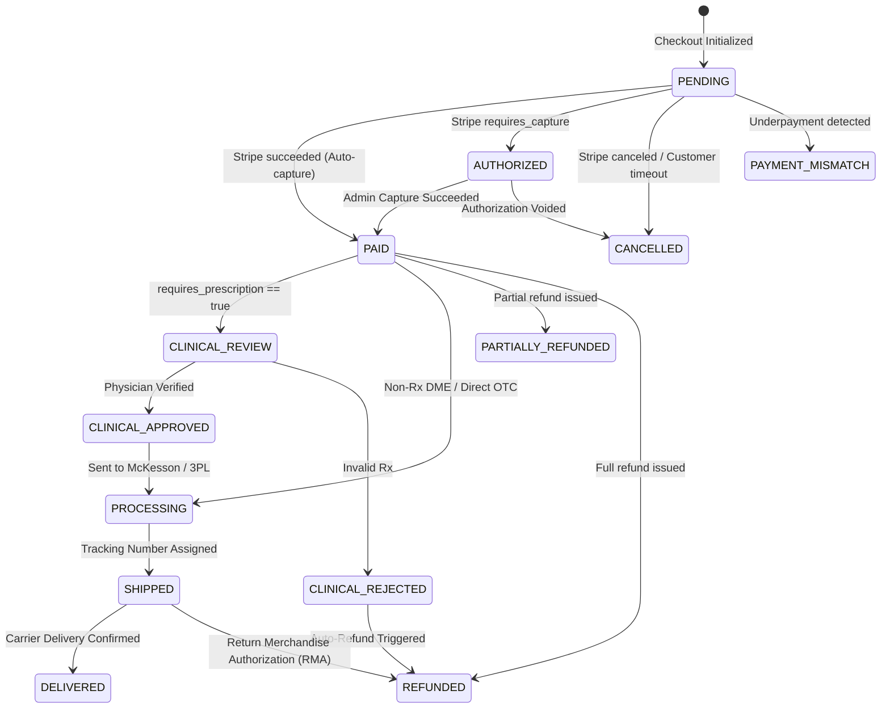

# BaeMeds.com — Phase 6 Payment & Order State Machine

**Date:** October 16, 2026  
**Auditor:** Independent Principal Application Security Auditor & Senior Payments Reliability Engineer  
**Scope:** Canonical Order and Payment State Machine, Allowed Transitions, and Fulfillment Eligibility Gates.

---

## 1. Canonical State Definitions

### Order Status (`orders.status`)
1. `PENDING`: Order initialized; awaiting asynchronous payment confirmation or authorization.
2. `AUTHORIZED`: Funds held by payment processor under manual capture mode. **Fulfillment locked.**
3. `PAID`: Funds captured and authoritatively verified. Eligible for prescription check / fulfillment.
4. `CLINICAL_REVIEW`: Prescribed DME order held for physician review / script verification.
5. `CLINICAL_APPROVED`: Prescription verified by clinical staff. Eligible for warehouse drop-ship.
6. `PROCESSING`: Order sent to warehouse / McKesson for picking and packing.
7. `SHIPPED`: Tracking number assigned, carrier in possession.
8. `DELIVERED`: Confirmed carrier delivery.
9. `CANCELLED`: Order cancelled prior to shipment; inventory reservation released.
10. `REFUNDED`: 100% of captured payment returned to customer.
11. `PARTIALLY_REFUNDED`: Partial credit returned; balance retained.
12. `PAYMENT_MISMATCH`: Security hold triggered due to underpayment tampering.

### Payment Status (`orders.payment_status`)
- `unpaid`: Initial state.
- `pending`: Asynchronous processing pending (`processing`).
- `authorized`: Held under manual capture mode (`requires_capture`).
- `paid`: Succeeded and exact amount matched (`succeeded`).
- `failed`: Payment method failure / card declined (`failed`, `requires_payment_method`).
- `cancelled`: Intent cancelled (`canceled`).
- `refunded`: Full refund issued.
- `partially_refunded`: Partial refund issued.
- `underpaid`: Amount received < authoritative total.

---

## 2. Fulfillment Eligibility Rules

> [!IMPORTANT]
> **Zero-Fulfillment Invariant:** An order may NEVER transition to `PROCESSING` or be released for drop-ship fulfillment unless:
> 1. `payment_status` is strictly `'paid'`.
> 2. `status` is strictly `'PAID'` (or `'CLINICAL_APPROVED'` if `requires_prescription === true`).
> 3. Under NO circumstance does `AUTHORIZED`, `PENDING`, `unpaid`, or `pending` unlock inventory dispatch.

```
+--------------------------------------------------------------------------------+
|                        FULFILLMENT ELIGIBILITY MATRIX                          |
+----------------------+--------------------+------------------------------------+
| Order Status         | Payment Status     | Fulfillment Release Action         |
+----------------------+--------------------+------------------------------------+
| PENDING              | unpaid / pending   | ⛔ BLOCKED (Awaiting Payment)      |
| AUTHORIZED           | authorized         | ⛔ BLOCKED (Funds Not Captured)    |
| PAID                 | paid               | ✅ ELIGIBLE (OTC / Direct DME)     |
| CLINICAL_REVIEW      | paid               | ⛔ BLOCKED (Awaiting Rx Review)    |
| CLINICAL_APPROVED    | paid               | ✅ ELIGIBLE (Prescription Validated)|
| CLINICAL_REJECTED    | paid / refunded    | ⛔ BLOCKED (Refund Required)       |
| CANCELLED            | any                | ⛔ BLOCKED (Terminal Cancelled)    |
| REFUNDED             | refunded           | ⛔ BLOCKED (Terminal Refunded)     |
| PAYMENT_MISMATCH     | underpaid          | ⛔ BLOCKED (Security Investigation)|
+----------------------+--------------------+------------------------------------+
```

---

## 3. Allowed Transition Diagram



---

## 4. Anti-Regression & Terminal State Rules

1. **Terminal State Immutability:** Once an order reaches `CANCELLED` or `REFUNDED`, delayed Stripe webhooks (`payment_intent.succeeded` or `charge.succeeded`) are discarded and CANNOT revert the order to `PAID`.
2. **Refund Demotion Protection:** If an order is already marked `REFUNDED`, subsequent partial refund events cannot demote the state to `PARTIALLY_REFUNDED`.
3. **Capture Pre-condition:** Only orders in `AUTHORIZED` status can be captured. Attempts to capture `PENDING` or `CANCELLED` orders are rejected with HTTP 400.
